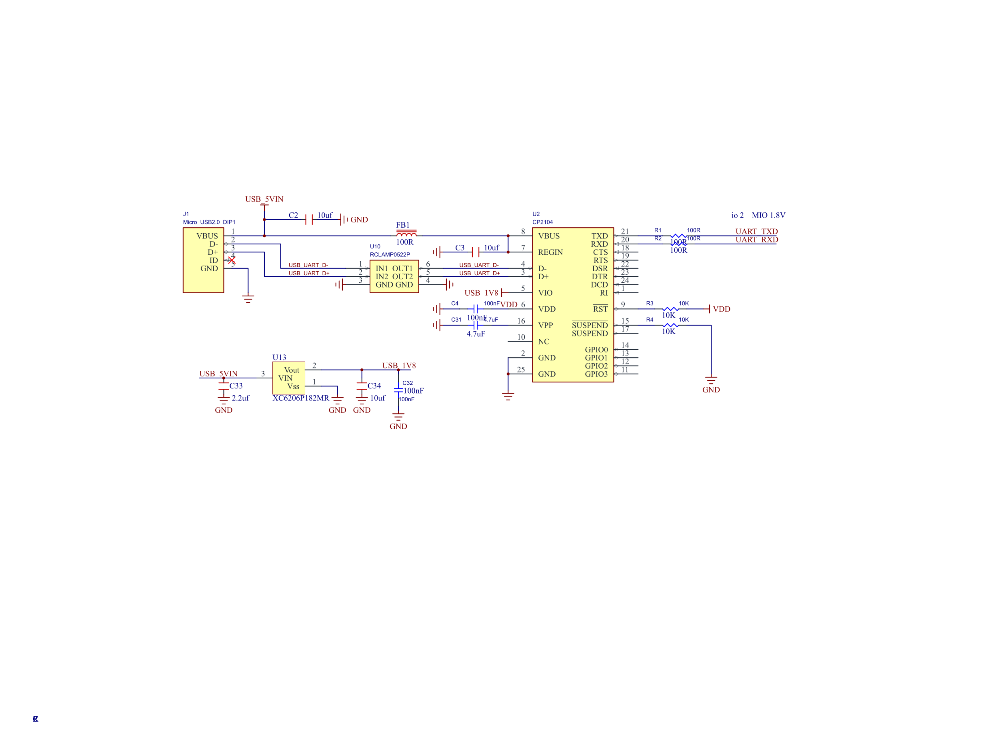
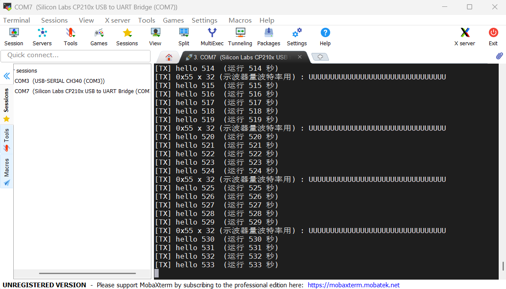
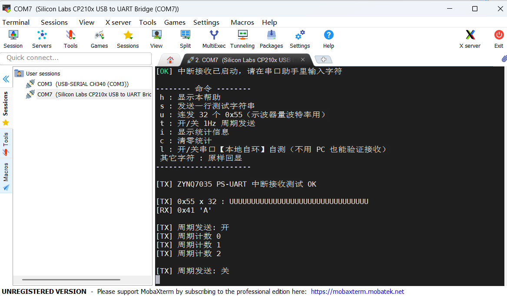
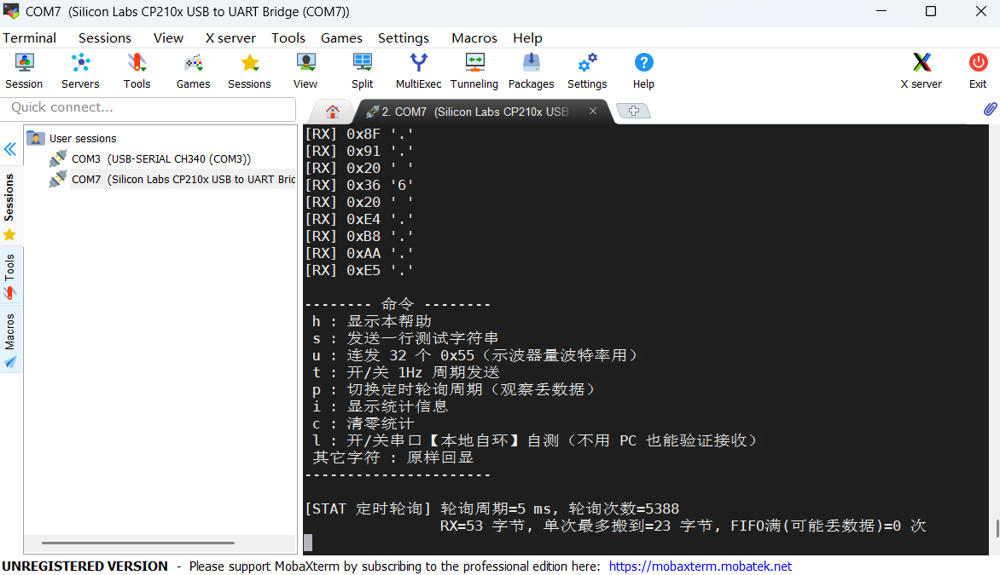
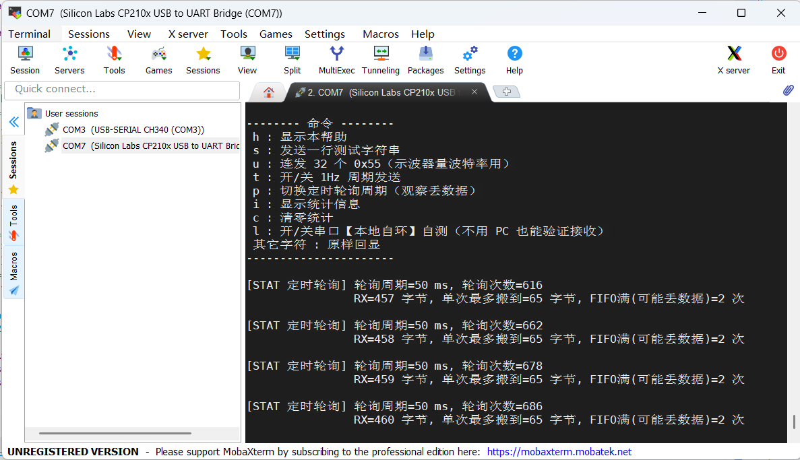
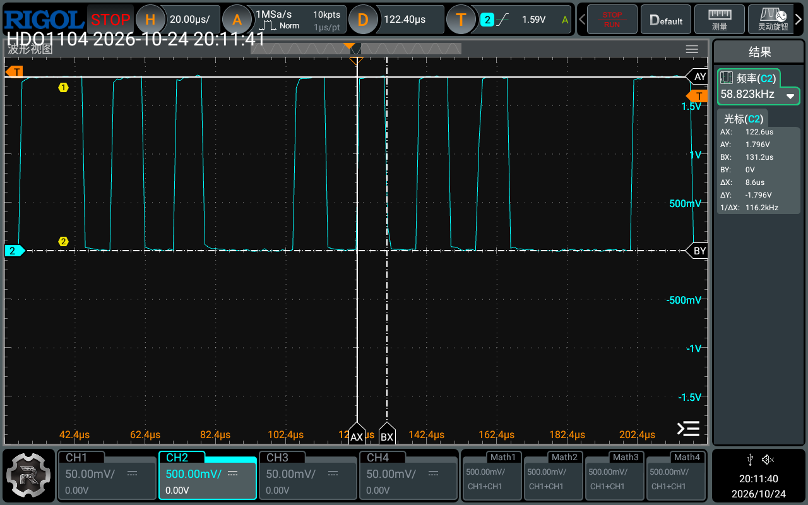

## 这个实验要解决什么

前面的实验几乎都在 PL 里写 Verilog。这一次换到另一边：**只用 PS，不写一行 Verilog，也不生成 bitstream**。Vivado 工程里只有一个 ZYNQ7 Processing System，剩下的事全在 Vitis 里用 C 完成。

实验目的是了解 Zynq 的串口编程和 UART 协议，具体分三步：

1. 用 PS 端串口往外发数据，和 PC 上的串口调试助手通信；
2. 改用**中断**方式接收数据；
3. 再改用**定时轮询**方式接收数据，和中断方式比较差异。

做完之后我最大的收获是：两种接收方式在功能上几乎一样，**差别全在「什么时候去取数据」**。这个差别平时看不出来，一旦数据连续涌进来，轮询周期没选好就会丢掉一半。

**器材**：MZ7XCORE676B 核心板（XC7Z035FFG676-2I）+ SOC 多功能评估模块底板、Digilent JTAG-HS1 下载器、Micro-USB 线、示波器。
**工具**：Vivado 2020.2、Vitis 2020.2、MobaXterm（串口助手）。

## 硬件连接

### 用的是哪个串口

底板上没有串口排针。串口从 Zynq 的 MIO 引脚出来，经板间连接器 HT2 到底板上的 CP2104，再由 Micro-USB 口（J1）接到电脑。电脑侧装好 CP210x 驱动后，我这台机器上出现的是 COM7。

| 方向 | Zynq PS | BGA 球 | 连接器 | 底板网络名 | 串阻 | CP2104 引脚 |
|---|---|---|---|---|---|---|
| PS 发送 → PC | UART1_TXD = **MIO48** | B21 | HT2.B44 | `UART_RXD` | R2 | pin20 RXD（输入） |
| PC → PS 接收 | UART1_RXD = **MIO49** | A18 | HT2.B43 | `UART_TXD` | R1 | pin21 TXD（输出） |

> **底板上的网络名是按 CP2104 的引脚起的，方向和 Zynq 一侧相反。** 叫 `UART_RXD` 的那根线，其实是 PS 的发送线。用示波器看 PS 发出的波形时，要探 R2 这一侧。

<figure class="diagram"><svg viewBox="0 0 720 200" role="img" aria-label="PS 串口通信链路：Zynq UART1 经 HT2 连接器到 CP2104，再经 Micro-USB 到 PC"><rect x="20" y="60" width="140" height="80" rx="8" fill="currentColor" opacity=".1" stroke="currentColor" stroke-width="2"/><text x="90" y="92" text-anchor="middle" fill="currentColor" font-size="14" font-family="monospace">Zynq PS</text><text x="90" y="114" text-anchor="middle" fill="currentColor" font-size="12" font-family="monospace" opacity=".7">UART1 · 1.8V</text><path d="M160 84h110M160 116h110" stroke="currentColor" stroke-width="2"/><path d="M262 78l8 6-8 6M168 110l-8 6 8 6" fill="none" stroke="currentColor" stroke-width="2"/><text x="215" y="76" text-anchor="middle" fill="currentColor" font-size="11" font-family="monospace">MIO48 TX</text><text x="215" y="136" text-anchor="middle" fill="currentColor" font-size="11" font-family="monospace">MIO49 RX</text><rect x="270" y="60" width="90" height="80" rx="8" fill="none" stroke="currentColor" stroke-width="2" stroke-dasharray="4 4"/><text x="315" y="96" text-anchor="middle" fill="currentColor" font-size="13" font-family="monospace">HT2</text><text x="315" y="114" text-anchor="middle" fill="currentColor" font-size="11" font-family="monospace" opacity=".7">B44 / B43</text><path d="M360 84h70M360 116h70" stroke="currentColor" stroke-width="2"/><text x="395" y="76" text-anchor="middle" fill="currentColor" font-size="11" font-family="monospace">R2</text><text x="395" y="136" text-anchor="middle" fill="currentColor" font-size="11" font-family="monospace">R1</text><rect x="430" y="60" width="110" height="80" rx="8" fill="currentColor" opacity=".1" stroke="currentColor" stroke-width="2"/><text x="485" y="96" text-anchor="middle" fill="currentColor" font-size="14" font-family="monospace">CP2104</text><text x="485" y="116" text-anchor="middle" fill="currentColor" font-size="11" font-family="monospace" opacity=".7">USB-UART</text><path d="M540 100h60" stroke="currentColor" stroke-width="2"/><text x="570" y="90" text-anchor="middle" fill="currentColor" font-size="11" font-family="monospace">J1</text><rect x="600" y="70" width="100" height="60" rx="8" fill="none" stroke="currentColor" stroke-width="2"/><text x="650" y="105" text-anchor="middle" fill="currentColor" font-size="14" font-family="monospace">PC COM7</text><text x="360" y="182" text-anchor="middle" fill="currentColor" font-size="12" font-family="monospace" opacity=".7">底板网络名：R2 侧叫 UART_RXD，R1 侧叫 UART_TXD（以 CP2104 为准）</text></svg><figcaption>图 1：PS 串口通信链路</figcaption></figure>

### 引脚是怎么确认的

这一步花的时间比写代码还多。Zynq 的 UART1 只能映射到固定的几组 MIO 上，所以要确认的其实是两件事：板子用的是哪一组，以及 TX、RX 有没有接反。我用了三份独立的资料互相对照：

- **底板 connector 原理图**：`UART_TXD` 落在 HT2.B43，`UART_RXD` 落在 HT2.B44。
- **核心板第 17 页 connector**：同一个 HT2 的 B43、B44 上是同名网络，旁边 B41/B42 的 1.8V 电源和 A41/A42 的 MIO51/MIO50 也和底板对得上。
- **核心板第 6 页 BANK_PS**：`UART_RXD` 连到球 B21，`UART_TXD` 连到球 A18。再用 Vivado 查 xc7z035ffg676-2 的封装数据，B21 是 PS_MIO48_501，A18 是 PS_MIO49_501。

`UART_RXD` 接的是 CP2104 的输入端，只能由 PS 驱动，所以它必须是 TXD（MIO48）。这和封装数据给出的结果一致，三份资料都没有矛盾。

> **核心板 PDF 里的引脚名比它自己那条引线低约 2.76 pt。** 按「同一行」去读，会把串口认到 MIO47、MIO48 上。必须用 Vivado 的封装数据核对，不能只靠肉眼看图。

### 电平是 1.8V，不是 3.3V

核心板第 7 页上，`VCCO_MIO1_501` 接的是 AUX1V8。MIO16 到 MIO53 都在这组电源下，所以串口是 **1.8V 逻辑**。



底板这边也能印证。CP2104 的 VIO（pin5）接 USB_1V8，由 U13 稳压得到。U13 的原理图符号名写的是 XC6206P332MR（3.3V），但底板 BOM 里 U13 是 **XC6206P182MR（1.8V）**，网络名也叫 USB_1V8。我以 BOM 为准，所以 CP2104 的 I/O 电平是 1.8V，和 Zynq 一侧对得上。

### 其他必须填对的硬件参数

| 项目 | 数值 | 出处 |
|---|---|---|
| PS 输入时钟 | 33.3333 MHz | 核心板第 6 页，有源晶振 |
| PS DDR3 | 2 × MT41K256M16RE-125，32 bit | 核心板第 8 页 |
| JTAG | 底板 CON1，14 脚 2×7，**2.0 mm 间距** | 底板原理图 |

PS 时钟填错，波特率会整体偏掉，串口助手里全是乱码。JTAG 排针是 2.0 mm 间距，2.54 mm 的排线需要转接。

## 原理

### 一帧数据在线上长什么样

UART 是异步串行接口，收发双方没有共享时钟。接收方等到起始位的下降沿，就把自己的计数器清零重新对齐，之后按约定的波特率在每一位的**中点**采样。

本实验用 **115200-8-N-1**：115200 bit/s、8 位数据、无校验、1 位停止位。总线空闲时是高电平，起始位拉低，数据位低位在前，最后停止位回到高电平。

<figure class="diagram"><svg viewBox="0 0 720 210" role="img" aria-label="0x55 的 UART 帧：空闲高电平、起始位、LSB 先发的 8 位数据和停止位，每位 8.68 微秒"><path d="M30 60H90V130H140V60H190V130H240V60H290V130H340V60H390V130H440V60H490V130H540V60H640" fill="none" stroke="currentColor" stroke-width="2.6" stroke-linejoin="round"/><g stroke="currentColor" stroke-width="1" stroke-dasharray="3 5" opacity=".45"><path d="M90 46V146M140 46V146M190 46V146M240 46V146M290 46V146M340 46V146M390 46V146M440 46V146M490 46V146M540 46V146M590 46V146"/></g><g fill="currentColor" font-size="12" font-family="monospace" text-anchor="middle"><text x="60" y="40">空闲</text><text x="115" y="164">起始</text><text x="165" y="164">D0</text><text x="215" y="164">D1</text><text x="265" y="164">D2</text><text x="315" y="164">D3</text><text x="365" y="164">D4</text><text x="415" y="164">D5</text><text x="465" y="164">D6</text><text x="515" y="164">D7</text><text x="565" y="164">停止</text></g><g fill="currentColor" font-size="11" font-family="monospace" text-anchor="middle" opacity=".7"><text x="115" y="182">0</text><text x="165" y="182">1</text><text x="215" y="182">0</text><text x="265" y="182">1</text><text x="315" y="182">0</text><text x="365" y="182">1</text><text x="415" y="182">0</text><text x="465" y="182">1</text><text x="515" y="182">0</text><text x="565" y="182">1</text></g><path d="M90 30H590M96 24l-6 6 6 6M584 24l6 6-6 6" fill="none" stroke="currentColor" stroke-width="1.4" opacity=".7"/><text x="340" y="22" text-anchor="middle" fill="currentColor" font-size="12" font-family="monospace">1 帧 = 10 位 ≈ 86.8 µs</text><text x="640" y="54" text-anchor="end" fill="currentColor" font-size="11" font-family="monospace" opacity=".7">1.8V</text><text x="640" y="200" text-anchor="end" fill="currentColor" font-size="11" font-family="monospace" opacity=".7">1 位 = 8.68 µs</text></svg><figcaption>图 2：0x55 的一帧（115200-8-N-1），虚线之间是一位</figcaption></figure>

几个后面会反复用到的数：

| 量 | 算法 | 数值 |
|---|---|---|
| 一位 | 1 / 115200 | 8.68 µs |
| 一帧（10 位） | 10 / 115200 | 86.8 µs |
| RX FIFO 从空到满 | 64 × 86.8 µs | 约 5.5 ms |

`0x55` 是 `0101 0101`，低位先发，加上起始位和停止位，线上正好是 `0 1 0 1 0 1 0 1 0 1`，一个标准方波。所以程序里专门留了连发 `0x55` 的功能，**给示波器量位宽用**。

### 波特率是怎么分出来的

Zynq 的 UART 用的是 Cadence 的控制器，波特率由两级分频得到：

```text
baud = 参考时钟 / (BAUDGEN × (BAUDDIV + 1))
```

上板后我用 JTAG 直接读了 UART1 的寄存器：参考时钟 100 MHz，`BAUDGEN = 124`，`BAUDDIV = 6`。

```text
100,000,000 / (124 × 7) = 115,207 bps    与 115200 相差 0.006%
```

接收方每一帧都会在起始位上重新对齐，10 位累积下来的偏差只有 0.06% 个位，离「偏出半个位」差得很远。一般 UART 能容忍双方 2%～3% 的偏差。

也正因为如此，**串口助手能正常显示文字，本身就同时证明了波特率、数据位、停止位、校验位都配对了**。参数错一个，看到的就是乱码。

### 两种取数据的方式

UART1 的接收 FIFO 有 64 字节。字节进了 FIFO 之后，CPU 总得找个时机把它搬走。本实验比较的就是这个时机：

- **中断方式（事件驱动）**：FIFO 里的数据到达阈值（RXOVR）、满了（RXFULL）或接收超时（TOUT），UART 就产生 82 号中断，经 GIC 送到 Cortex-A9。数据一到就处理。
- **定时轮询方式（时间驱动）**：串口一个中断都不开。用 SCU 私有定时器按固定周期产生 29 号中断，在定时器中断里看一眼 FIFO，有数据就搬走。

<figure class="diagram"><svg viewBox="0 0 720 230" role="img" aria-label="两种接收方式的数据流对比：中断方式由 UART 事件触发，轮询方式由定时器触发，前后两端相同"><g fill="none" stroke="currentColor" stroke-width="2"><rect x="20" y="85" width="110" height="60" rx="8"/><rect x="170" y="85" width="110" height="60" rx="8"/><rect x="450" y="85" width="110" height="60" rx="8"/><rect x="600" y="85" width="100" height="60" rx="8"/><rect x="320" y="24" width="100" height="56" rx="8" stroke-dasharray="4 4"/><rect x="320" y="150" width="100" height="56" rx="8" stroke-dasharray="4 4"/><path d="M130 115h40M280 115h20M300 115V52h20M300 115v63h20M420 52h10v63h20M420 178h10V115M560 115h40"/></g><g fill="currentColor" font-size="13" font-family="monospace" text-anchor="middle"><text x="75" y="112">MIO49</text><text x="225" y="112">RX FIFO</text><text x="370" y="50">UART 中断</text><text x="370" y="176">定时器中断</text><text x="505" y="112">环形缓冲</text><text x="650" y="112">主循环</text></g><g fill="currentColor" font-size="11" font-family="monospace" text-anchor="middle" opacity=".7"><text x="75" y="132">RX 引脚</text><text x="225" y="132">64 字节</text><text x="370" y="68">#82 · 数据到就触发</text><text x="370" y="194">#29 · 每 N ms 一次</text><text x="505" y="132">512 字节</text><text x="650" y="132">回显 / 命令</text></g></svg><figcaption>图 3：两种接收方式只在中间一环不同</figcaption></figure>

两条路的前后两端完全一样，业务代码也几乎一样。**差别只在触发源**，以及随之而来的延迟、抖动和丢包风险。

轮询方式有一条硬约束：周期必须明显小于 FIFO 能撑住的 5.5 ms。超过这个时间，FIFO 先满，后进来的字节就丢了。

## Vivado 配置

本实验是 PS-only，Block Design 里只放一个 ZYNQ7 Processing System，跑完 Block Automation 后按下表配置。PS 的时钟、MIO 复用和 DDR 参数最终由 `ps7_init` 在调试器启动时写进寄存器，所以**不需要生成 bitstream**。

| 配置项 | 取值 | 为什么 |
|---|---|---|
| 器件 | xc7z035ffg676-2 | 核心板是 XC7Z035FFG676-2I |
| PS 输入时钟 | 33.333333 MHz | 板上晶振就是这个，填错波特率整体偏 |
| UART1 | 使能，IO 选 MIO 48..49 | 板子就接在这两个脚上 |
| **MIO Bank1 电压** | **LVCMOS 1.8V** | 默认 3.3V，和硬件不符 |
| DDR3 | MT41K256M16 RE-125，32 bit | 板上两颗组成 32 位 |
| SD1、ENET0、USB0 等 | 关闭 | SD1 正好用 MIO46～51，会和 UART1 抢脚 |

Validate 之后导出 XSA，导出时**不勾** Include bitstream。我的工程用 Tcl 脚本一键生成，日志里会自检打印这两行，必须是 1.8V：

```text
### MIO48 IOTYPE = LVCMOS 1.8V
### MIO49 IOTYPE = LVCMOS 1.8V
```

上板后读到的 `MIO_PIN_48 = 0x12E0`、`MIO_PIN_49 = 0x12E1`，也和这个配置一致：UART1 功能、1.8V、带上拉，前者是输出，后者是输入。

Vitis 里用这份 XSA 建平台，再建三个 Empty Application，每个应用放入公共头文件 `uart_lab.h` 和一个对应的 `main_*.c`，删掉模板自带的 `helloworld.c`。

## 关键代码讲解

代码分三层：三个 `main_*.c` 是应用层，各对应一个实验步骤；`uart_lab.h` 是公共层，放环形缓冲、寄存器级发送、打印和延时；最底下是 BSP 自带的 XUartPs 驱动和 GIC 驱动。

### 设备号和中断号：最隐蔽的一个坑

本设计只使能了 UART1。BSP 只给实际存在的实例编号，所以 UART1 被编成了 XUARTPS 的 **0 号实例**。可中断号不会跟着重新编号：

```c
/* xparameters.h 里实际生成的定义 */
#define XPAR_XUARTPS_0_DEVICE_ID   XPAR_PS7_UART_1_DEVICE_ID  /* 实例 0 就是 UART1 */
#define XPAR_XUARTPS_0_BASEADDR    0xE0001000                 /* UART1 的地址 */
#define XPAR_PS7_UART_1_INTR       82                         /* UART1 的中断号 */
/* 而 XPAR_XUARTPS_0_INTR = 59，是 UART0 的中断 */
```

设备号用 `XPAR_XUARTPS_0_*` 没问题。中断号要是也跟着写成 `XPAR_XUARTPS_0_INTR`，GIC 会把处理函数挂到 UART0 上，**程序能编译、能下载，就是永远不进中断**。所以公共头文件里中断号只用 PS7 命名来取：

```c
#if defined(XPAR_PS7_UART_1_INTR)
  #define LAB_UART_INT_ID  XPAR_PS7_UART_1_INTR   /* = 82，对应 ps7_uart_1 */
#else
  #define LAB_UART_INT_ID  82U
#endif
```

### 步骤一：发送就是「等空位，写 FIFO」

发送一个字节只涉及两个寄存器：通道状态寄存器 SR 里的 TXFULL 位，和 FIFO 数据寄存器。

```c
static inline void uart_tx_byte(u32 base, u8 c)
{
    /* 等 TX FIFO 有空间：TXFULL=0 */
    while (XUartPs_ReadReg(base, XUARTPS_SR_OFFSET) & XUARTPS_SR_TXFULL) {
        ;
    }
    XUartPs_WriteReg(base, XUARTPS_FIFO_OFFSET, (u32)c);
}
```

这里没用驱动的 `XUartPs_Send()`，因为它内部会先关掉 UART 的全部中断再恢复，在中断接收的程序里会留下一个短暂的屏蔽窗口。直接写 FIFO 寄存器不碰中断，也最能看清「阻塞式发送」是怎么回事。

`xil_printf()` 走的是同一条通路：BSP 的 stdout 就指向唯一使能的 UART1，只是多了格式解析。步骤一的主循环每秒发一行计数，每 5 秒插一串 32 个 `0x55`。

### 步骤二：中断接收的配置顺序

```c
XUartPs_SetHandler(&g_uart, (XUartPs_Handler)uart_event_handler, &g_uart);
XUartPs_SetFifoThreshold(&g_uart, 1U);   /* RX FIFO 有 1 字节就触发 */
XUartPs_SetRecvTimeout(&g_uart, 8U);     /* 超时 = 8×4 = 32 个字符时间 */
XUartPs_SetInterruptMask(&g_uart,
        XUARTPS_IXR_RXOVR | XUARTPS_IXR_RXFULL |
        XUARTPS_IXR_TOUT  | XUARTPS_IXR_OVER);
XUartPs_Recv(&g_uart, g_rxbuf, RX_CHUNK); /* 挂上第一块接收缓冲 */
```

之后在 GIC 里连接 82 号中断，把 `XScuGic_InterruptHandler` 挂到 ARM 的 IRQ 异常向量上，最后用 `Xil_ExceptionEnable()` 打开 CPU 的 IRQ。这几步里有两处最容易漏：

- **`XUartPs_Recv()` 不只是「读数据」，它是给驱动挂接收缓冲。** 不挂缓冲，驱动就永远不会回调。
- **`Xil_ExceptionEnable()` 决定中断能不能进到 CPU。** 唯独漏了这一句，现象和中断号挂错一模一样。

驱动在缓冲收满或接收超时时回调，参数 `event_data` 是这次收到的字节数。回调里只做两件事：把数据搬进环形缓冲，再重新挂一块缓冲。

```c
static void uart_event_handler(void *call_back_ref, u32 event, unsigned int event_data)
{
    XUartPs *uart = (XUartPs *)call_back_ref;
    u32 i;

    switch (event) {
    case XUARTPS_EVENT_RECV_DATA:   /* 接收缓冲收满 */
    case XUARTPS_EVENT_RECV_TOUT:   /* 接收超时：不足一缓冲的数据也上报 */
        for (i = 0; i < event_data; i++) {
            ring_push(g_rxbuf[i]);
        }
        g_stat.rx_bytes += (u32)event_data;
        g_stat.irq_count++;
        (void)XUartPs_Recv(uart, g_rxbuf, RX_CHUNK);  /* 重新挂缓冲 */
        break;
    case XUARTPS_EVENT_RECV_ERROR:  /* 帧/奇偶/溢出等错误 */
    case XUARTPS_EVENT_RECV_ORERR:
        g_stat.rx_overrun++;
        (void)XUartPs_Recv(uart, g_rxbuf, RX_CHUNK);
        break;
    default:
        break;
    }
}
```

**中断里不做打印、不做延时。** 回显和命令解析都放在主循环里，从环形缓冲取一个字节处理一个。环形缓冲的写指针只在中断里动，读指针只在主循环里动，单生产者单消费者，不需要关中断加锁。

`RX_CHUNK` 我设成了 1，每收一个字节回调一次，交互回显的延迟最小。改成 64 能大幅减少中断次数，代价是零星几个字节要等接收超时才上报。

### 步骤三：把「取数据」交给定时器

轮询版的串口只做初始化和设波特率，不设回调、不开中断。GIC 里连接的是 SCU 私有定时器的 29 号中断。

SCU 私有定时器的时钟是 CPU 主频的一半。本板 CPU 是 666.67 MHz，定时器就是 333.33 MHz：

```c
/* 装载值 = 定时器时钟 / 轮询频率；1 kHz 时是 333333 */
XScuTimer_LoadTimer(&g_timer, LAB_TIMER_FREQ_HZ / g_poll_hz);
XScuTimer_EnableAutoReload(&g_timer);   /* 自动重装，周期性触发 */
XScuTimer_EnableInterrupt(&g_timer);    /* 允许产生中断（漏了永远不进ISR）*/
XScuTimer_Start(&g_timer);
```

定时器中断里就是「轮询」真正发生的地方：

```c
static void timer_poll_handler(void *call_back_ref)
{
    XScuTimer *timer = (XScuTimer *)call_back_ref;
    u32 base = g_uart.Config.BaseAddress;
    u32 n = 0;
    u8  c;

    /* 必须清定时器中断标志，否则只会进一次 */
    if (XScuTimer_IsExpired(timer)) {
        XScuTimer_ClearInterruptStatus(timer);
    }
    g_stat.poll_count++;

    /* FIFO 已满：上一轮到现在进来的数据超过 64 字节，轮询太慢了 */
    if (XUartPs_ReadReg(base, XUARTPS_SR_OFFSET) & XUARTPS_SR_RXFULL) {
        g_stat.rx_overrun++;
    }

    /* 把 RX FIFO 里现有的数据全部搬进环形缓冲 */
    while (!(XUartPs_ReadReg(base, XUARTPS_SR_OFFSET) & XUARTPS_SR_RXEMPTY)) {
        c = (u8)XUartPs_ReadReg(base, XUARTPS_FIFO_OFFSET);
        ring_push(c);
        g_stat.rx_bytes++;
        n++;
    }
    if (n > g_max_batch) {
        g_max_batch = n;                 /* 单次最多搬了几个 */
    }
}
```

「FIFO 满」这个计数是本实验的关键观测量。它增长，就说明这一轮里很可能已经有字节被丢掉了。按 `p` 可以在 1、2、5、10、20、50 ms 之间循环切换轮询周期，直接观察它怎么变。

### 串口命令

两个接收程序共用一套命令，轮询版多一个 `p`：

| 按键 | 作用 |
|---|---|
| `h` | 显示帮助 |
| `s` | 发送一行测试字符串 |
| `u` | 连发 32 个 `0x55`，给示波器用 |
| `t` | 开关 1 Hz 周期发送 |
| `i` | 显示统计：收到字节数、中断或轮询次数、溢出次数 |
| `c` | 清零统计 |
| `l` | 开关串口本地自环 |
| `p` | 切换轮询周期（仅轮询版） |
| 其他字符 | 回显成 `[RX] 0x41 'A'` 的形式 |

本地自环是 Zynq UART 控制器在内部把 TX 接回 RX，不经过引脚，也不会和 CP2104 冲突。USB 串口还没弄通的时候，可以先用它验证接收通路。

## 下载与运行

1. 底板 Micro-USB（J1）接电脑，这是串口，不是下载口；JTAG 下载器接 CON1；底板 DC 座上电。
2. Vitis 里右键应用，选 `Run As → Launch on Hardware`。Run Configuration 里 **必须勾上 Run ps7_init**，它负责配 PS 的时钟、MIO 和 DDR。
3. 本设计没有 bitstream，Program FPGA 一项留空。
4. 串口助手选 CP210x 对应的 COM 口，参数 115200-8-N-1。

程序跑在 DDR 里，掉电就没了。换另一个程序前先停掉当前的，再 Launch。

## 实测结果

以下数据都是在同一块板子上实际跑出来的，串口助手是 MobaXterm，串口为 COM7。

### 步骤一：只发送



截图里程序已经运行了 533 秒，计数从 514 到 533 连续无跳变，1 Hz 节拍是准的。每 5 秒一串 `UUUU…`，就是 32 个 `0x55`。中文和数字都显示正常，说明帧格式和波特率是对的。

### 步骤二：中断接收



输入 `A`，立刻回显 `[RX] 0x41 'A'`；`t` 能开关周期发送，`u` 能连发 `0x55`。用脚本一次性连续发 300 个字节，再看统计：

| 指标 | 实测 |
|---|---|
| 发送 | 300 字节 + 3 个命令字节 |
| 收到 | **303 字节** |
| UART 中断次数 | 305 次 |
| 溢出 | **0 次** |

`RX_CHUNK = 1` 时基本是每个字节一次中断，另外几次是超时或阈值中断。**中断方式在 115200 下突发 300 字节，一个没丢。**

### 步骤三：定时轮询接收

先验证定时器装载值。按 `p` 每切一档，程序都会打印新的装载值，和「333.33 MHz ÷ 轮询频率」逐一对得上：

| 轮询周期 | 频率 | 装载值 |
|---|---|---|
| 2 ms | 500 Hz | 666666 |
| 5 ms | 200 Hz | 1666666 |
| 10 ms | 100 Hz | 3333333 |
| 20 ms | 50 Hz | 6666666 |
| 50 ms | 20 Hz | 16666667 |

然后是核心的丢包对比。下面是我在不同周期下突发发送一长串数据后按 `i` 得到的统计：

| 轮询周期 | 单次最多搬到 | FIFO 满 | 结论 |
|---|---|---|---|
| 1 ms | 12 字节 | 0 次 | 200 字节全部收到 |
| 5 ms | 23 字节 | 0 次 | 不丢 |
| 20 ms | 65 字节 | 1 次 | 开始丢 |
| 50 ms | 65 字节 | 2 次 | 300 字节只收到 142 个 |





这些数字和理论能对上：

- 1 ms 里最多进 1000 ÷ 86.8 ≈ 11.5 个字节，实测单次最多搬到 12 个。
- 5 ms 里最多进 57 个字节，还在 64 字节的 FIFO 容量内，所以不丢。
- 50 ms 里要进 570 多个字节，FIFO 必然溢出。单次搬到 65 个比 FIFO 深度多 1，是因为读 FIFO 的过程中又进来了一个。

50 ms 那组发了 300 字节只收到 142 个，**丢了一半以上**。同样的数据量，中断方式一个没丢。

### 示波器：量出位宽

探头接 R2 靠连接器的一侧，也就是 `UART_RXD` 网络，看 PS 发出的 `0x55`。



| 测量项 | 理论值 | 实测值 |
|---|---|---|
| 一位宽度 | 8.68 µs | 8.6 µs（光标 ΔX） |
| 反算波特率 | 115200 | 约 116.3 kbit/s，偏差 0.9% |
| 方波频率 | 57.6 kHz | 58.823 kHz（示波器频率读数） |
| 高电平 | 1.8 V | 1.796 V |

频率读数和理论差了 2% 左右。示波器是 1 MSa/s 采样，每个点 1 µs，一位只有 8 到 9 个采样点，光标定位和自动频率测量都受这个分辨率限制。寄存器反算出来的误差只有 0.006%，所以这里的偏差我认为主要来自测量本身，而不是波特率配错了。

高电平 1.796 V 和 1.8V 的 Bank 电压一致，说明电平配置也是对的。

### 两种方式对比

| 对比项 | 中断方式 | 定时轮询 |
|---|---|---|
| 触发机制 | 数据到达就触发（事件驱动） | 定时器周期触发（时间驱动） |
| 突发 300 字节 | 全部收到 | 1 ms 不丢，50 ms 丢一半以上 |
| 响应延迟 | 数据一到就处理 | 0 到 1 个轮询周期，有抖动 |
| CPU 占用 | 只在有数据时占用 | 没数据也要定期进中断 |
| 实现 | 要配 GIC、异常向量、回调 | 只要一个定时器，逻辑直白 |

响应延迟这一行是按原理推的，我还没有用示波器双通道实测过回显延迟。

## 踩过的坑

**1. 网络名的方向是反的。**

底板上的 `UART_RXD`、`UART_TXD` 是按 CP2104 的引脚命名的，和 Zynq 一侧相反。按名字去探波形会探反：测 PS 发送要探 R2 那一侧的 `UART_RXD`，测 PC 发下来的数据才探 R1。

**2. MIO Bank1 默认是 3.3V。**

Vivado 里 PS 默认把 MIO Bank1 当作 3.3V，而本板 `VCCO_MIO1_501` 接的是 1.8V 的 AUX1V8。这一项不改，配置就和硬件不符。改成 LVCMOS 1.8V 后，日志里 MIO48、MIO49 的 IOTYPE 都是 LVCMOS 1.8V。

**3. BSP 的实例编号和中断号不一致。**

前面「关键代码」里讲过：`XPAR_XUARTPS_0_DEVICE_ID` 是 UART1，但 `XPAR_XUARTPS_0_INTR` 是 UART0 的 59 号中断。用错了能编译也能下载，就是不进中断。改用 `XPAR_PS7_UART_1_INTR`（82）后正常。

**4. 接收少最后几个字节。**

驱动只在缓冲收满或接收超时时回调。按块接收时，末尾凑不满一块的字节要靠超时上报。不调 `XUartPs_SetRecvTimeout()`，这些字节就一直留在 FIFO 里。

**5. 轮询周期过大丢数据。**

50 ms 周期下 FIFO 满计数为 2，串口助手上明显缺字节；改到 5 ms 后单次最多 23 字节，计数为 0。周期上限由 FIFO 深度和字节时间决定，115200 下约 5.5 ms，实际要留余量。

**6. 核心板 PDF 的文本层会错位一格。**

06_BANK_PS 页里，引脚名比它自己的引线低约 2.76 pt，按「同一行」去读会把串口认到 MIO47、MIO48 上。用 Vivado 的封装数据核对才定准。再加上「网络 MIO50 必须落在 MIO50 引脚上」这条，错位一格的方案自相矛盾，可以排除。

**7. 底板 BOM 和原理图符号名不一致。**

U13 的符号名写的是 3.3V 的 XC6206P332MR，BOM 里却是 1.8V 的 XC6206P182MR。我以 BOM 和网络名 USB_1V8 为准，判断 CP2104 的 I/O 是 1.8V。

## 下一步

- 用示波器双通道实测回显延迟：CH1 接 R1 看 PC 发来的字节，CH2 接 R2 看回显，对比中断方式和不同轮询周期下的延迟分布。
- 把 `RX_CHUNK` 改成 64 编译一次，看中断次数和零星字节回显延迟各怎么变。
- 波特率改成 9600 时，一个字节约 1.04 ms，64 字节约 66 ms，可以验证轮询周期上限会不会跟着放宽。
- 数据量更大时，可以提高 UART 在 GIC 里的优先级，或者改用 DMA 搬运。
- 做 BOOT.BIN，让程序上电自启动，不再依赖 JTAG 下载。
